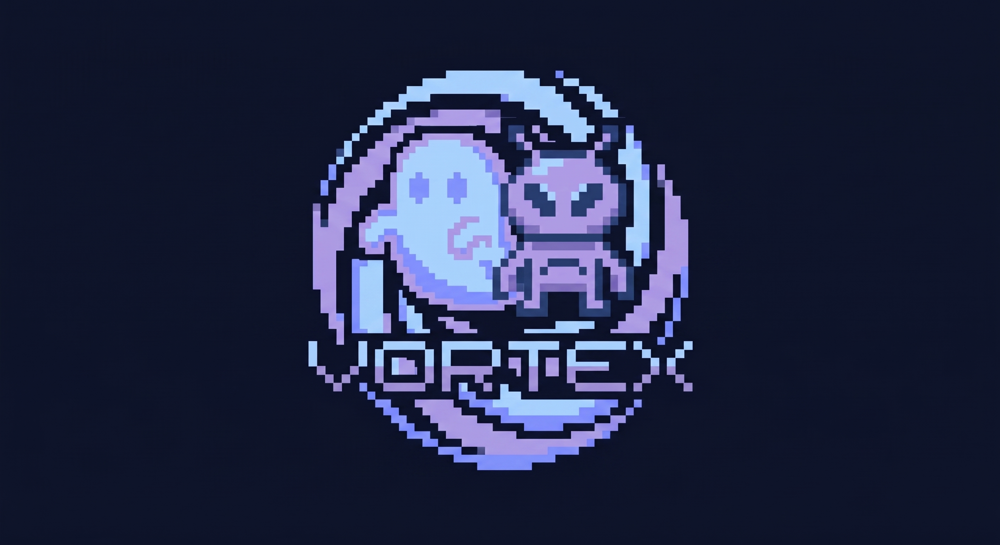

# VORTEX · Hero Jump

## Apresentação da empresa

**Nome:** VORTEX, empresa fictícia de desenvolvimento de jogos digitais para navegador, criada em 2026 pelo fundador fictício Rafael Azevedo.

**Descrição e serviços:** criação de jogos web com partidas rápidas e controles simples. Os serviços incluem desenvolvimento de mecânicas, interfaces, personalização de personagens, cenários e obstáculos, testes de jogabilidade e adaptação para computador e celular.

**Jogo desenvolvido:** Hero Jump, um arcade de corrida automática com quatro personagens selecionáveis, itens temáticos e três níveis progressivos de dificuldade.

**Público-alvo:** jogadores casuais, estudantes e iniciantes que procuram partidas rápidas no navegador, usando teclado ou toque.

**Proposta e objetivo:** sobreviver pelo maior tempo possível, saltar para desviar dos obstáculos e coletar itens, acumular pontos e disputar uma posição no ranking das dez melhores pontuações.

A apresentação e a história também estão disponíveis em `pages/sobre-nos.php`. Empresa, fundador e história de origem são fictícios e fazem parte de um projeto acadêmico individual.

## Executar

No Laragon, copie a pasta `jogosenai` para `www`, inicie PHP e MySQL e abra `http://localhost/jogosenai/`. PHP precisa de PDO MySQL e mbstring.

Ajuste a conexão em `php/conexao.php` se necessário. Também são aceitas as variáveis DB_HOST, DB_PORT, DB_USER, DB_PASSWORD e DB_NAME. O banco `hero_jump` e a tabela `ranking` são criados automaticamente na primeira conexão. Por padrão, a conexão usa `root` sem senha; configure a senha do seu ambiente em `DB_PASSWORD` ou no arquivo de conexão.

## Pastas usadas

- `index.php`: jogo e abertura com a marca VORTEX.
- `pages/sobre-nos.php`: apresentação e história da empresa e do jogo; não depende de banco ou JavaScript.
- `php/conexao.php`: conexão e criação da estrutura do ranking.
- `php/obter-ranking.php`: consulta das dez maiores pontuações.
- `php/salvar-ranking.php`: gravação da pontuação ao encerrar uma partida.
- `js/script.js`: controles, animação dos coletáveis, pontuação e chamadas do ranking.
- `css/styles.css`: estilos do jogo, da abertura e da história.
- `assets/`: cenários, obstáculos, marca, personagens e coletáveis.

Não há pasta `api`, `database`, `config` ou `docs`, nem formulário, JavaScript de contato ou CSS separado do Sobre nós. A documentação está neste README.

## Jogo

Escolha um dos quatro personagens e pule com Espaço, seta para cima ou toque no cenário. Evite os obstáculos e colete itens: cada coleta concede 50 pontos, além da pontuação por sobrevivência. O contador é zerado em cada nova partida.

A colisão dos obstáculos desconsidera 18% de cada lateral, 30% do topo e 5% da base da imagem. Isso reduz a área anterior de colisão em 20% na largura e aproximadamente 19% na altura, tolerando raspadas nas bordas. O ajuste vale para os quatro personagens e Raichu em todos os níveis, sem modificar o tamanho visual ou a coleta de itens. As margens ficam em `HITBOX_OBSTACULO`, em `js/script.js`.

## Níveis de dificuldade

O nível atual aparece na barra superior e muda automaticamente pelo tempo efetivo de sobrevivência. A barra mostra jogador, nível, itens e pontos; a velocidade é controlada internamente e não possui indicador na interface. Coletar itens não antecipa a mudança de nível, e os 1,2 segundo da evolução do Pikachu não contam como tempo jogado.

| Nível | Tempo de partida ativa | Velocidade |
| --- | --- | --- |
| 1 — Fácil | 0 a menos de 20 segundos | 0,8x até 1,15x |
| 2 — Médio | 20 a menos de 45 segundos | 1,15x até 1,6x |
| 3 — Difícil | A partir de 45 segundos | 1,6x até o limite de 2,0x aos 90 segundos |

A aceleração é contínua, inclusive na passagem entre níveis. Obstáculos e coletáveis acompanham a mesma velocidade. O cenário rola mais devagar, mas também acelera com o nível; painéis alternados e espelhados permitem repetir as imagens existentes sem corte na volta do ciclo. A opção de movimento reduzido mantém o cenário parado e conserva as regras de dificuldade.

Ao perder, a rolagem para. Ao reiniciar, nível, velocidade e posição do cenário voltam ao início. Os tempos e velocidades podem ser ajustados na constante `NIVEIS`, em `js/script.js`; o limite final está em `VELOCIDADE_MAXIMA` e `TEMPO_VELOCIDADE_MAXIMA`.

### Validação dos níveis

Verificação em Chromium com relógio simulado, usando os quatro personagens nas larguras de 1280 e 390 px. As chamadas de ranking foram simuladas neste teste de interface; o código de banco não foi alterado.

| Caso | Resultado |
| --- | --- |
| Antes de 20 s, aos 20 s e aos 45 s | Fácil, Médio e Difícil exibidos nos limites previstos |
| Aceleração dos obstáculos e rolagem do cenário | Velocidade progressiva; limite de 2,0x mantido após 90 s |
| Cinco coletas no início com Sonic | +250 pontos, sem antecipar a passagem de nível |
| Evolução iniciada 0,5 s antes de cada transição | Cenário, pontos e velocidade pausados; transição apenas após completar o tempo ativo |
| Pulo, colisão e reinício após chegar ao Difícil | Partida encerra, cenário para e reinício volta ao Fácil em 0,8x |
| Movimento reduzido e tela de 320 px | Cenário parado, níveis ativos e interface sem rolagem horizontal |

Doce, lata e pergaminho são coletáveis animados com folhas em `assets/collectibles/sprites/` e mapeamento em `assets/collectibles/frames.json`. Sonic usa um anel em GIF. Os PNGs de referência/fallback permanecem em `assets/collectibles/`. Obstáculos usam apenas as imagens `assets/obstaculo-*.png`.

## Sobre nós

A página reúne a origem fictícia da VORTEX, sua especialidade e serviços, a história do Hero Jump, seu público-alvo, proposta e objetivo. A terceira seção contém uma tabela com 11 requisitos funcionais (RF01 a RF11) e quatro requisitos não funcionais (RNF01 a RNF04), com código, descrição e tipo. O atalho “Ver tabela de requisitos” leva diretamente à seção; também é possível abrir `pages/sobre-nos.php#requisitos`. Não há catálogo de jogos, equipe ou contato. Edite os textos diretamente em `pages/sobre-nos.php`. O logotipo fica em `assets/brand/vortex.jpg`.

## Atualizar uma versão antiga

Extraia este ZIP em uma pasta nova. Extrair por cima da pasta anterior não remove arquivos antigos. Preserve seus ajustes de conexão, aplicando-os ao novo `php/conexao.php`. Nenhuma pontuação ou mensagem já gravada no banco é apagada por esta atualização.

## Easter egg: Pikachu e Raichu

Somente o Pikachu pode evoluir. Ao alcançar pelo menos 100 pontos reais da partida, uma Pedra do Trovão substitui o próximo coletável. Ela usa a folha de 20 quadros em `assets/collectibles/sprites/thunderstone.png`, recortada na exibição pelo mapeamento em `assets/collectibles/frames.json`.

Coletar a pedra concede os 50 pontos do item e transforma o personagem em Raichu. Sua corrida usa os três quadros recortados da primeira linha do sprite enviado, em `assets/characters/raichu/corrida-01.png` a `corrida-03.png`. O fundo azul foi removido, os pixels do personagem foram preservados e os pés ficam alinhados em células transparentes de 56 × 50 px. A sequência é 1 → 2 → 3 → 2, com 100 ms por quadro, controlada pelo loop da partida; a animação para durante a evolução e no Game Over.

Cenário, obstáculos, velocidade e pontuação continuam na mesma partida. Raichu mantém a proporção dos quadros recortados, com largura de 125 px no computador e 118 px no celular. A evolução preserva o progresso do pulo e a posição dos pés. Se perder a pedra, ela reaparece até ser coletada. Depois da evolução, os coletáveis normais retornam. Cada nova partida começa como Pikachu; o evento não se aplica aos outros três personagens.

A evolução também apresenta os quatro quadros `assets/effects/evolution-thunder-1.jpg` a `evolution-thunder-4.jpg` como efeito animado elétrico sobre a tela inteira. O fundo preto desaparece pela mistura de cores no CSS. Durante os 1,2 segundo do efeito, pontuação, aceleração, obstáculos, itens e pulo são pausados. Depois, a partida retoma do mesmo ponto. Com movimento reduzido, um quadro estático dos raios aparece com entrada e saída suaves. Para testar no seu computador, abra o projeto no Laragon e jogue com Pikachu até atingir 100 pontos. Se a pedra passar, ela voltará a aparecer até ser coletada.
